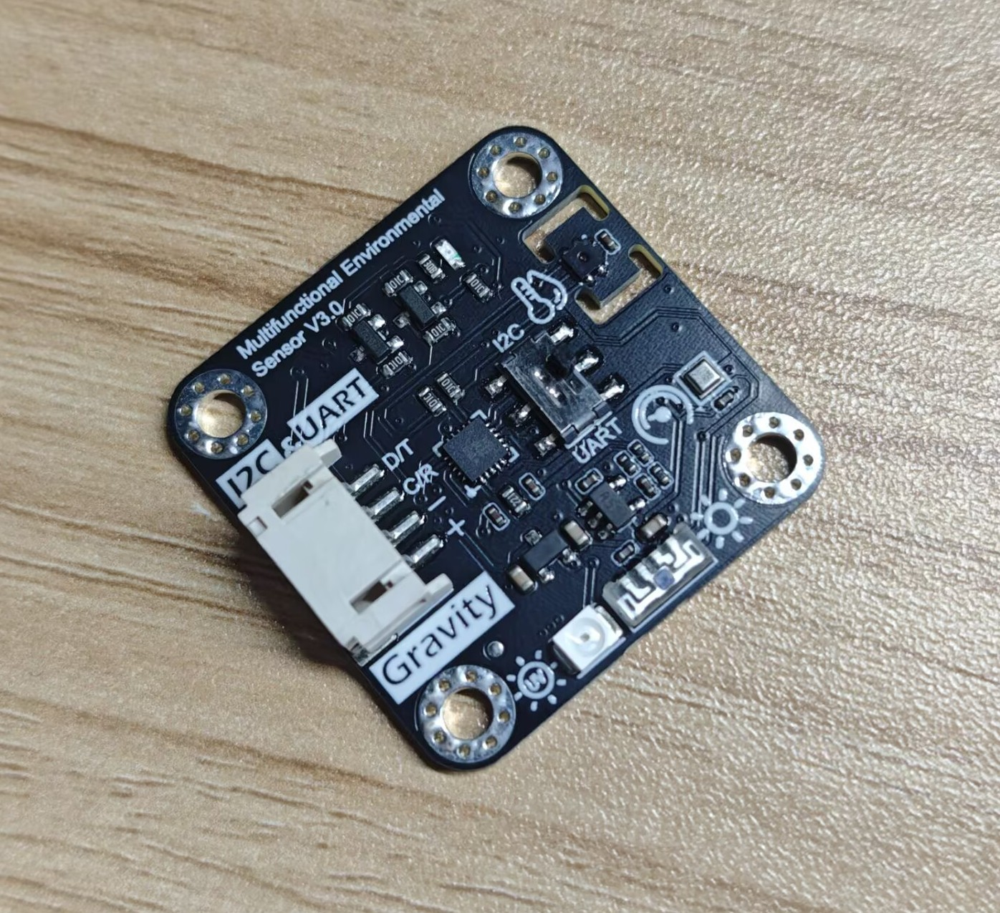
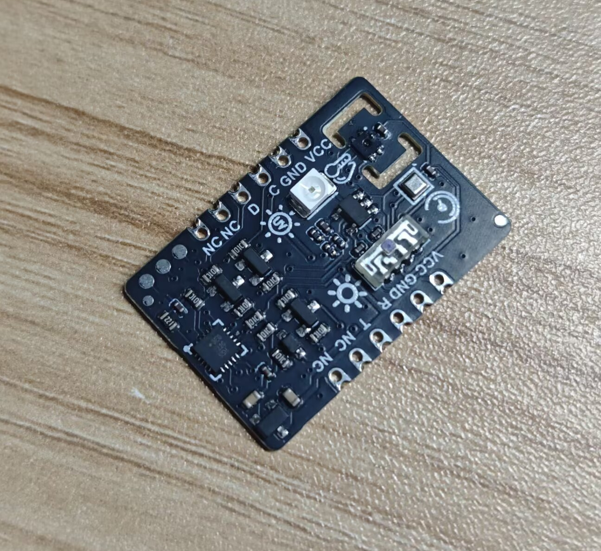

DFRobot_EnvironmentalSensor
===========================

* [English Version](./README.md)

SEN0500/SEN0501 是一个气象传感器，模块上集成了，紫外线传感器、光照传感器、大气压强传感器、温湿度传感器，模块有Gravity接口和Breakout两种接口方式，通过串口或I2C进行数据传输，通过模块上的切换开关进行通信方式选择。
DFRobot_Environmental_Sensor库是DFRobot专门为该传感器写的一个Arduino驱动库，用户可以用此驱动库来驱动Ardunio主控连接的传感器获取传感器数据。

## V1.0


## V3.0




## 产品链接（https://www.dfrobot.com）

    SKU：SEN0500/SEN0501

## 目录

* [概述](#概述)
* [库安装](#库安装)
* [方法](#方法)
* [兼容性](#兼容性)
* [历史](#历史)
* [创作者](#创作者)

## 概述

这是一个多气象传感器得库，使用该库能够很便捷得获取温度、湿度、压强、紫外线强度、自然光线强度和海拔等信息，
模块还提供了Gravity版本和breakout版本方便使用。

### 硬件版本

硬件版本印在模块正面丝印上，例如 "Multifunctional Environmental Sensor V3.0"。把它传给 `get_ultraviolet_intensity()` 即可；示例 `get_data.py` 中通过 `SENSOR_VERSION` 变量设置。

温度、湿度、光照、气压和海拔在所有版本上的读取方式完全一致，只有紫外线传感器及其读数含义不同：

硬件版本（丝印） | API参数 | 紫外线传感器 | 寄存器原始值 | `get_ultraviolet_intensity()` 返回值 |
---------------- | ------- | ------------ | ------------ | ------------------------------------ |
V1.0（`V1.0`） | `SENSOR_V1_0` | ML8511，模拟输出 | 传感器电压的10位ADC值 | UV指数，0~15，无单位 |
V2.0（`V2.0`）   | `SENSOR_V2_0` | LTR390，数字输出 | 传感器计数值（20位，6倍增益） | 等效UVA辐照度，mW/cm² |
V3.0（`V3.0`）   | `SENSOR_V3_0` | GUVA-S12SD，模拟输出 | 放大器输出的10位ADC值 | 352nm UVA灯条件下的等效辐照度，mW/cm² |

版本选错不会报错，只会得到错误的紫外线数值。旧的按芯片命名的常量 `ML8511`、`LTR390UV`、`S12SD` 仍然可用，分别等同于 `SENSOR_V1_0`、`SENSOR_V2_0`、`SENSOR_V3_0`。

## 库安装

要使用这个库，首先将库下载到Raspberry Pi，然后打开例程文件夹。要执行一个例程demox.py，请在命令行中输入python demox.py。例如，要执行control_led.py例程，你需要输入:

```python
python control_led.py
```

## 方法

```python
'''!
    @brief 初始化SEN0500/SEN0501传感器
    @brief 初始化SEN0500/SEN0501传感器
    @return 返回值初始化状态
    @retval 0  成功
    @retval -1 失败
  '''
  def begin(self):

  '''!
    @brief 获取SEN0500/SEN0501温度数据
    @param units 温度数据单位选择
    @n     TEMP_C 摄氏度
    @n     TEMP_F 华氏度
    @return 返回获取的温度数据
  '''
  def get_temperature(self,unist):

  '''!
    @brief 获取SEN0500/SEN0501湿度数据
    @return 返回获取的湿度数据
  '''
  def get_humidity(self):

  '''!
    @brief 获取SEN0500/SEN0501紫外线数据
    @param version 模块丝印上的硬件版本
    @n SENSOR_V1_0：V1.0 模块（ML8511），返回UV指数，0~15，无单位
    @n SENSOR_V2_0：V2.0 模块（LTR390），返回等效UVA辐照度，单位mW/cm2
    @n SENSOR_V3_0：V3.0 模块（GUVA-S12SD），返回等效UVA辐照度，单位mW/cm2
    @return 返回所选硬件版本对应的紫外线测量结果
  '''
  def get_ultraviolet_intensity(self, version=SENSOR_V1_0):

  '''!
    @brief 获取SEN0500/SEN0501光线强度数据
    @return 返回获取的光线强度数据
  '''
  def get_luminousintensity(self):

  '''!
    @brief 获取SEN0500/SEN0501大气压强数据
    @param units 大气压强数据单位选择
    @n            HPA 百帕
    @n            KPA 千帕
    @return 返回获取的大气压强数据
  '''
  def get_atmosphere_pressure(self, units):

  '''!
    @brief 获取SEN0500/SEN0501海拔数据
    @return 返回获取的海拔数据
  '''
  def get_elevation(self):
```

## 兼容性

* RaspberryPi Version

| Board        | Work Well | Work Wrong | Untested | Remarks |
| ------------ | :-------: | :--------: | :------: | ------- |
| RaspberryPi2 |          |            |    √    |         |
| RaspberryPi3 |          |            |    √    |         |
| RaspberryPi4 |    √    |            |          |         |

* Python Version

| Python  | Work Well | Work Wrong | Untested | Remarks |
| ------- | :-------: | :--------: | :------: | ------- |
| Python2 |          |            |    √    |         |
| Python3 |    √    |            |          |         |

## 历史

- 2026-10-26 - 1.4.0版本，紫外线换算改为按硬件版本选择（`SENSOR_V1_0` / `SENSOR_V2_0` / `SENSOR_V3_0`）而非按芯片名，三个示例合并为 `get_data.py`，补充 V1.0 与 V2.0/V3.0 的差异说明。
- 2026-10-22 - 1.3.0版本，V2.0 LTR390与V3.0 GUVA-S12SD紫外线数据统一为mW/cm²。
- 2021-08-31 - 1.0.0 版本

## 创作者

Written by thdyyl(yuanlong.yu@dfrobot.com), 2026. (Welcome to our [website](https://www.dfrobot.com/))
